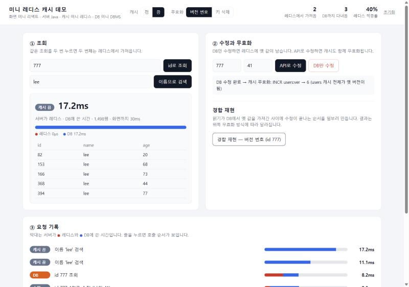
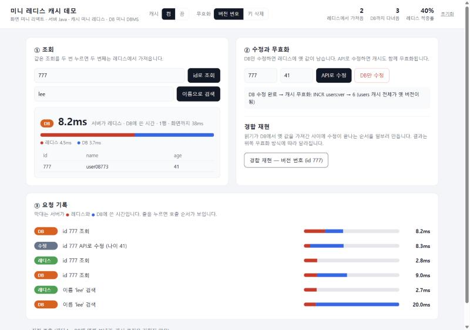

# 미니 레디스 개발 — 직접 만든 DB 앞에 직접 만든 레디스를 붙여 보기

직접 만든 미니 레디스를 지난주에 만든 미니 DBMS 앞에 붙이고, 웹 서버와 화면까지 연결해서 캐시가 실제로 얼마나 빨라지는지 비교했습니다.

결론: **캐시는 조회가 오래 걸리고 데이터가 잘 바뀌지 않을 때만 효과가 있었습니다.** 이미 빠른 조회에는 차이가 없었고, 수정이 조금만 섞여도 오히려 느려졌습니다.


## 목차
1. [화면이 보여 주는 것](#1-화면이-보여-주는-것)
2. [왜 만들었나](#2-왜-만들었나)
3. [DBMS에 수정 기능 넣기](#3-dbms에-수정-기능-넣기)
4. [미니 레디스](#4-미니-레디스)
5. [단순 비교: 차이가 거의 없었다](#5-단순-비교-차이가-거의-없었다)
6. [웹 서버와 화면으로 실제 요청 경로 만들기](#6-웹-서버와-화면으로-실제-요청-경로-만들기)
7. [캐시에 옛 값이 남는 문제](#7-캐시에-옛-값이-남는-문제)
8. [측정 결과](#8-측정-결과)
9. [실행](#9-실행)
10. [테스트](#10-테스트)
11. [합치면서 찾은 문제](#11-합치면서-찾은-문제)
12. [한계](#12-한계)
13. [저장소 구조](#13-저장소-구조)

---

## 1. 화면이 보여 주는 것

화면은 요청 하나가 **레디스에서 끝났는지, DB까지 다녀왔는지, 각각 얼마나 걸렸는지**를 보여 주려고 만들었습니다. 화면은 직접 만든 미니 리액트로 그렸습니다.

**상단**
- **캐시 켬 / 끔:** 끄면 모든 요청이 레디스를 건너뛰고 DB로 바로 갑니다. 캐시가 있을 때와 없을 때를 같은 화면에서 비교할 수 있습니다.
- **무효화 방식 (버전 번호 / 키 삭제):** DB를 수정했을 때 캐시를 어떻게 맞출지 고릅니다. 두 방식의 차이는 7절에서 설명합니다.
- **숫자 세 개:** 레디스에서 바로 가져온 횟수, DB까지 다녀온 횟수, 레디스 적중률입니다.

**① 조회**
- id로 조회하거나 이름으로 검색합니다. id 조회는 인덱스로 바로 찾고, 이름 검색은 DB가 10만 행을 전부 확인합니다.
- 결과 카드에 표시되는 것:
  - **배지:** 이 요청이 어디서 끝났는지
  - **큰 숫자:** 서버가 레디스와 DB에 쓴 시간의 합
  - **막대:** 그 시간 중 레디스(빨강)와 DB(파랑)가 차지한 비율
  - **표:** 결과 행 앞 5줄

| 배지 | 뜻 |
|---|---|
| 레디스 | 레디스에 있어서 바로 가져옴 |
| DB | 레디스에 없어서 DB까지 다녀옴. 가져온 값은 레디스에 60초 저장 |
| 캐시 끔 | 캐시를 꺼서 DB로 바로 감 |
| 캐시 안 함 | 결과가 256KB를 넘어 레디스에 넣지 않음 |
| 우회 | 레디스가 응답하지 않아 DB로 바로 감 |
| 수정 | 수정 요청 |

**② 수정과 무효화**
- **API로 수정:** DB를 바꾼 뒤 캐시도 무효화합니다. 정상적인 수정 경로입니다.
- **DB만 수정:** DB만 바꾸고 레디스에는 알리지 않습니다. 캐시에 옛 값이 남는 상황을 보여 주기 위한 버튼입니다.
- **경합 재현:** 수정 요청과 조회 요청의 순서가 꼬였을 때 캐시가 어떻게 되는지 일부러 만들어 봅니다. 결과는 빨강(옛 값이 남음) 또는 초록(새 값)으로 나옵니다.

**③ 요청 기록**
- 최근 요청 8개가 줄마다 막대와 함께 쌓입니다. 같은 조회의 첫 번째(DB)와 두 번째(레디스)를 위아래로 비교할 수 있습니다.
- 줄을 누르면 서버가 레디스와 DB를 어떤 순서로, 얼마나 걸려서 불렀는지 펼쳐집니다.

맨 아래 "직접 호출"은 레디스나 DB에 명령을 직접 보내는 개발용 창이라 평소에는 접어 둡니다.

## 2. 왜 만들었나

미니 DBMS를 먼저 만들었습니다. 그래서 레디스를 만든다면, DB 앞에 붙였을 때 실제로 얼마나 빨라지는지 직접 비교해 보고 싶었습니다.

과제에 둘을 합치라는 요구는 없었지만 합쳐서 비교하기로 했습니다. 화면은 그 전에 만든 미니 리액트의 엔진을 가져와 새로 만들었습니다. 그래서 이 저장소의 화면, 캐시, DB는 모두 직접 만든 것입니다.

## 3. DBMS에 수정 기능 넣기

처음 만든 DBMS는 넣기와 조회만 됐습니다. 캐시를 시험하려면 "DB 값이 바뀌었을 때 캐시도 맞춰지는가"를 봐야 하는데, 값을 바꿀 수가 없었습니다.

수정이 어려웠던 이유는 저장 방식에 있었습니다. 전원이 나가도 데이터가 깨지지 않게 하려고 **파일에 이미 쓴 내용은 고치지 않고 뒤에 이어서만 쓰도록** 만들었기 때문입니다. 파일 형식 자체는 바꾸지 않았고, 이 원칙을 지키면서 수정을 넣었습니다.

| | 기존 | 변경 후 |
|---|---|---|
| 지원 명령 | INSERT · SELECT | + UPDATE · DELETE |
| 수정 방법 | 없음 | 바뀐 행 전체를 파일 끝에 새로 씀. 같은 id는 마지막 것이 최신 |
| 삭제 방법 | 없음 | "이 id는 지워짐" 기록(8바이트)을 파일 끝에 씀 |
| 파일 손상 검사 | id가 계속 커지기만 하면 정상 | 같은 id가 다시 나올 수 있어서, 살아 있는 id 목록으로 검사 |
| 인덱스(B+트리) | 넣기만 | 삭제 · 값 바꾸기 · 범위 순회 추가 |
| 전체 조회 순서 | 파일 순서 | 파일에 옛 버전이 섞여 있어서 id 순서로 |
| 대가 | — | 수정할수록 파일이 커지고, 전체 조회가 느려짐 (8절에서 다시 나옴) |

자세한 설계: `../미니DBMS/docs/architecture.md` 5.4b절, 결정 기록 #20~#24.

## 4. 미니 레디스

Java 21로, 외부 라이브러리 없이 만들었습니다. 원본은 `../미니레디스`이고 여기서는 `vendor/minired`에 복사해 씁니다.

**외부에서 쓰는 방법**
진짜 레디스와 같은 통신 규칙(RESP)을 따릅니다. 그래서 `redis-cli`나 Java 레디스 라이브러리(Jedis)를 그대로 붙여 쓸 수 있습니다. 기능 테스트도 직접 만든 클라이언트가 아니라 Jedis로 검증했습니다.

지원 명령: `PING` `SET`(NX · XX · EX · PX) `GET` `DEL` `EXISTS` `EXPIRE` `TTL` `INCR` `DBSIZE`

**해시 테이블**
- 같은 칸에 키가 겹치면 그 칸에 연결해서 저장합니다.
- 키 수가 칸 수만큼 차면 칸을 두 배로 늘립니다.
- 한 번에 전부 옮기면 그동안 모든 요청이 멈춥니다. 그래서 요청마다 한 칸씩, 요청이 없을 때는 0.1초마다 조금씩 나눠서 옮깁니다. 옮기는 도중에는 옛 배열과 새 배열을 둘 다 찾습니다.
- 키가 칸 수의 10% 아래로 줄면 테이블을 줄입니다.
- 해시 함수는 SipHash에 서버를 켤 때마다 바뀌는 키를 씁니다. 같은 칸에 몰리는 키를 일부러 만들어 서버를 느리게 하는 공격을 막기 위해서입니다.

**동시성**
- 여러 클라이언트가 동시에 접속해도 명령은 스레드 하나가 하나씩 실행합니다. 락이 없고, 명령 하나는 중간에 끊기지 않습니다.
- 해시 조회 하나는 아주 짧아서, 여러 스레드로 나눠도 얻는 것이 적다고 판단했습니다.
- 대신 "오래 걸리는 일은 한 번에 하지 않는다"는 규칙을 지킵니다. 위의 나눠 옮기기가 이 규칙에서 나왔습니다.
- 응답을 읽지 않는 클라이언트가 메모리를 다 쓰지 않도록, 보낼 데이터가 1MB를 넘으면 그 연결은 잠시 멈춥니다.

**만료**
- 키를 읽을 때 기간을 확인하고, 지났으면 지웁니다.
- 아무도 안 읽는 키가 계속 남지 않도록, 0.1초마다 기간 있는 키 20개를 뽑아 지난 것을 지웁니다. 뽑은 것 중 25% 넘게 지났으면 한 번 더 뽑습니다.

테스트 51개: 저장 · 조회 · 삭제, 테이블 늘리기 · 줄이기 도중의 조회, 만료, 동시 접속 시 합계, 조각나서 오는 요청, 잘못된 형식.

## 5. 단순 비교: 차이가 거의 없었다

레디스를 DB 앞에 붙이고 id로 조회해 봤는데, 레디스를 거치나 DB에 바로 가나 차이가 거의 느껴지지 않았습니다.

이유는 DB가 이미 빨랐기 때문입니다. id 조회는 인덱스(B+트리)를 써서, DB 안에서 찾는 시간은 1.9µs(100만 행 기준)입니다. 걸리는 시간은 대부분 DB와 주고받는 통신 시간이었습니다.

요청 하나씩 보내며 단계별 시간을 쟀습니다(30회 · 10회 중앙값).

| | DB 호출 (레디스에 없을 때) | 레디스 호출 (있을 때) | 화면까지 걸린 시간 |
|---|---|---|---|
| id 조회 | 1.96ms | 0.81ms | 7.4ms → 4.2ms |
| 이름 검색 (10만 행 전체 확인) | 6.1ms | 1.0ms | 10.4ms → 3.6ms |

id 조회는 줄어든 시간이 3ms 정도라 사람이 느끼기 어렵습니다. 그래서 레디스만 따로 재지 않고, 실제 요청이 지나가는 길을 전부 만들어 보기로 했습니다.

## 6. 웹 서버와 화면으로 실제 요청 경로 만들기

```
화면 (미니 리액트)
   │
   ▼
웹 서버 (Java)
   ├─▶ 미니 레디스   먼저 확인. 있으면 바로 응답
   └─▶ 미니 DBMS     없으면 DB에서 가져와 레디스에 60초 저장
```

**처음 검색: DB까지 다녀옴.** 이름 `lee` 검색은 DB가 10만 행을 전부 확인해야 해서 20.0ms가 걸렸고, 대부분이 파란색(DB) 시간입니다.


**같은 검색 한 번 더: 레디스에서 가져옴.** 2.7ms로 줄었고 DB 시간이 0이 됐습니다. 요청 기록에 두 줄이 위아래로 쌓여 바로 비교됩니다.


**호출 순서.** 요청 기록의 줄을 누르면 서버가 한 일이 순서대로 나옵니다. id 1234를 처음 조회하면 레디스에서 버전 확인 → 레디스에서 키 확인(없음) → DB 조회 → 레디스에 저장, 이렇게 4번을 부릅니다. 두 번째는 레디스 2번으로 끝납니다(7.8ms → 2.1ms). 맨 아래 id 777 조회(71.9ms)는 서버를 막 켠 뒤 첫 요청이라 느립니다.


**캐시를 끄면 매번 DB까지 갑니다.** 같은 검색을 두 번 해도 두 번 다 DB 시간만 나옵니다.



## 7. 캐시에 옛 값이 남는 문제

**DB만 수정하면 옛 값이 나옵니다.** id 777의 나이를 DB에서 41로 바꿨지만, 레디스는 그 사실을 모르기 때문에 다시 조회하면 레디스에서 옛 값 25가 나옵니다.


**API로 수정하면 캐시가 무효화됩니다.** 수정 결과에 "INCR users:ver"가 보입니다. 다시 조회하면 DB까지 다녀와서 새 값 41이 나옵니다.



**그런데 수정한 키를 지우는 것만으로는 부족합니다.** 순서가 꼬이면 깨집니다.

1. 요청 A가 DB에서 옛 값을 읽습니다 (아직 레디스에 넣기 전)
2. 요청 B가 DB를 수정하고 레디스에서 키를 지웁니다
3. 요청 A가 1에서 읽은 옛 값을 레디스에 넣습니다 → 옛 값이 60초 동안 남습니다

경합 재현 버튼은 이 순서를 일부러 만듭니다. 키 삭제 방식에서는 옛 값이 남아 빨간색으로 나옵니다.


**버전 번호 방식에서는 새 값이 나옵니다.** 레디스에 버전 숫자(`users:ver`)를 두고 캐시 키 이름에 넣습니다(`users:v8:id:777`). API로 수정하면 DB 수정이 성공한 뒤 버전을 하나 올립니다. 늦게 온 옛 값은 이미 버려진 옛 버전 이름에 들어가서 아무도 읽지 않습니다.


| 방식 | 검색 결과 캐시 | 위 순서 꼬임 | 대가 |
|---|---|---|---|
| 기간(TTL)만 | 60초 동안 옛 값 | 60초 동안 옛 값 | 없음 |
| 키 삭제 | 어떤 검색 키를 지울지 모름 | 60초 동안 옛 값 | 없음 |
| **버전 번호 (선택)** | 한 번에 무효화 | 문제 없음 | 행 하나만 바뀌어도 테이블 캐시 전체를 새로 채움 |

## 8. 측정 결과

<!-- bench:start -->
조건: 10만 행, 가상 사용자 8명이 30초 동안 계속 요청(k6). 읽기의 80%는 id 조회, 20%는 이름 검색. 같은 조건을 3번씩 재서 중앙값을 적었습니다.

| 수정 비율 | 캐시 | 처리량 (요청/초) | id 조회 | 이름 검색 | 레디스 적중률 |
|---|---|---|---|---|---|
| 0% | 켬 | 586 | 7.4ms | **10.7ms** | 60% |
| 0% | 끔 | 522 | 7.5ms | **28.8ms** | - |
| 1% | 켬 | **531** | 8.0ms | 26.0ms | **19%** |
| 1% | 끔 | **595** | 6.7ms | 27.3ms | - |
| 10% | 켬 | 535 | 8.0ms | 27.7ms | 4% |
| 10% | 끔 | 305 | 11.6ms | 37.9ms | - |

시간은 중간값(p50)입니다. 원자료: [bench/results/summary.md](bench/results/summary.md)

**3번 모두 같은 방향으로 나온 것만 결론으로 썼습니다.**
1. **이름 검색은 약 3배 빨라졌습니다** (28.8ms → 10.7ms). 오래 걸리는 조회는 캐시 효과가 분명했습니다.
2. **id 조회는 차이가 없었습니다** (7.5ms → 7.4ms). 이미 빠른 조회는 캐시가 줄일 시간이 없었습니다.
3. **수정이 1%만 섞여도 캐시를 켠 쪽이 느렸습니다.** 수정할 때마다 버전이 올라 캐시 전체가 버려지기 때문에, 레디스 적중률이 60%에서 19%로 떨어졌습니다. 남는 것은 레디스를 거치는 추가 시간뿐입니다.

**측정하면서 주의한 점**
- DB 파일은 수정할수록 커집니다(3절). 그래서 측정을 반복할수록 "캐시 끔" 쪽이 느려졌습니다. 수정 10% · 캐시 끔에서 이름 검색 p99가 409ms까지 튀었습니다. 그대로 두면 캐시가 실제보다 좋아 보이기 때문에, 측정할 때마다 데이터를 처음 상태로 되돌렸습니다.
- 처음 1번만 쟀을 때는 처리량이 1.6배 좋아진 것처럼 나왔지만, 3번 다시 재 보니 우연이었습니다. 같은 조건에서도 처리량이 회차마다 최대 2.5배 차이 나서, 처리량보다 종류별 시간과 적중률로 결론을 냈습니다.
<!-- bench:end -->

## 9. 실행

Docker만 있으면 됩니다.

```bash
docker compose up -d --build
```

- 화면: http://127.0.0.1:8088
- 처음 실행할 때 10만 행을 넣습니다 (약 3초)
- 처음 상태로 되돌리기: `bash scripts/reset.sh`
- 측정 다시 하기: `bash bench/run.sh` (6개 조건 × 3번 × 30초 + 회차마다 데이터 다시 넣기)

## 10. 테스트

| 종류 | 위치 | 수 | 확인하는 것 |
|---|---|---|---|
| 단위 | `demo/src/test` (Docker 빌드 때 실행) | 23 | 캐시 흐름, 무효화, 순서 꼬임 재현, 입력 검사 |
| 실제 스택 | `demo/test/e2e.sh` | 77 | 레디스 · DB를 실제로 멈췄다 살리기, 순서 꼬임 재현, 이상한 입력 |
| 원본 | 각 원본 저장소 | 레디스 51 · DBMS 9 · 미니 리액트 198 | 각자 저장소에서 실행 |

```bash
docker compose up -d --build && bash demo/test/e2e.sh
```

확인한 경우: 없는 id, 256KB 넘는 결과(캐시 안 함), 한글 · 16바이트 경계 · 깨진 글자, `' OR '1'='1` 같은 입력, 레디스가 꺼졌을 때(DB로 바로 감), DB가 꺼졌을 때(캐시에 있는 건 응답), DB 응답 도중 실패(캐시에 안 넣음).

## 11. 합치면서 찾은 문제

각자 테스트할 때는 안 보이던 문제가 합치자 나왔습니다.

| 증상 | 원인 | 해결 |
|---|---|---|
| 데이터 넣기가 413 오류 | DBMS가 쓰는 HTTP 라이브러리가 특정 형식의 본문을 8KB로 제한 | 요청 형식을 `text/plain`으로 |
| 레디스 저장이 전부 실패 | 미니 레디스에 `SETEX` 명령이 없음 (Jedis가 보냄) | `SET k v EX n`으로 |
| 모든 응답이 약 40ms | 웹 서버가 헤더와 본문을 따로 보내서 생기는 TCP 지연(Nagle) | 지연 끄기 설정 |
| 레디스를 끄면 우회가 1.5초 | 레디스 주소 찾기 실패가 오래 걸리고, 실패 결과를 10초 기억 | 1초 차단 + 주소 기억 시간 단축 |

## 12. 한계

- **서버가 꺼질 때 데이터 보존은 구현하지 않았습니다.** 여기서 레디스는 DB의 복사본이라 잃어도 다시 채울 수 있습니다. 방법(명령 기록을 1초마다 파일에 저장)만 설계했습니다.
- **측정 환경:** 노트북 한 대에서 CPU 2개로 모든 프로그램이 같이 돌아 측정값이 흔들립니다. 절대값보다 조건끼리 비교로 읽어 주세요.
- **같은 키에 요청이 몰리는 경우:** 캐시가 버려진 직후 같은 키 요청이 한꺼번에 DB로 갑니다. 측정에서 관찰만 했습니다.
- **SQL을 문자열로 만듭니다.** 입력 검사와 따옴표 처리로 막았지만, 근본 해결은 DBMS 쪽 작업입니다.

## 13. 저장소 구조

```
compose.yaml      미니 레디스 · 미니 DBMS · 데이터 넣기 · 웹 서버 (+ k6 측정)
VENDOR.md         복사해 온 원본과 커밋 SHA
vendor/           원본 복사본 (여기서 고치지 않음)
demo/             웹 서버 (Java) · 테스트 · web/ (화면)
bench/            측정 시나리오 · 결과
docker/           DBMS 실행 이미지 · 데이터 넣기
scripts/          sync-vendor.sh (원본 → vendor) · reset.sh (처음 상태로)
docs/             흐름 지도 · 결정 기록(질문 지도) · 발표 대본 · 화면 캡처
```

원본은 각자 저장소에서 만들고 테스트한 뒤, `scripts/sync-vendor.sh`로 커밋된 내용만 복사합니다.

| 원본 | 여기 | 쓰는 부분 |
|---|---|---|
| `../미니레디스` | `vendor/minired` | 서버 전체 |
| `../미니DBMS` | `vendor/minidb` | 실행 파일만 빌드 |
| `../mini-react` | `vendor/mini-react` | 엔진 + 런타임 (화면은 새로 만듦) |
