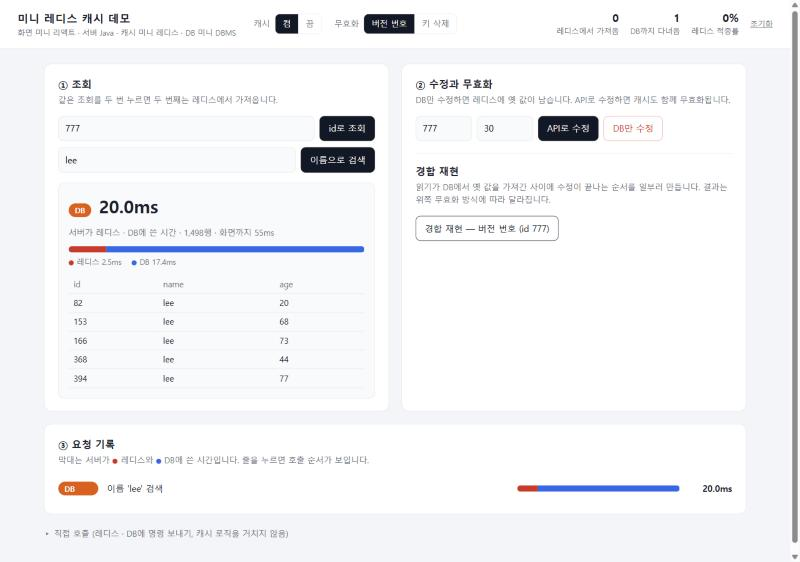

# 미니 레디스 개발 — 직접 만든 DB 앞에 직접 만든 레디스를 붙여 보기

직접 만든 미니 레디스를 직접 만든 미니 DBMS 앞에 붙여서, 레디스가 정말 DB보다 빠른지 실제 요청으로 확인해 봤습니다.

**결론:** 이름 검색처럼 DB가 오래 일해야 하는 조회는 약 3배 빨라졌습니다. 반대로 id 조회처럼 DB가 이미 빠른 조회는 차이가 없었고, 수정이 조금만 섞여도 오히려 느려졌습니다.


## 목차
1. [왜 만들었나](#1-왜-만들었나)
2. [각각 어떻게 만들었나](#2-각각-어떻게-만들었나)
3. [합쳐서 테스트하기](#3-합쳐서-테스트하기)
4. [결과와 판단](#4-결과와-판단)
5. [실제 서비스와 다른 점](#5-실제-서비스와-다른-점)
6. [실행 · 테스트](#6-실행--테스트)
7. [한계](#7-한계)

---

## 1. 왜 만들었나

레디스는 키와 값을 메모리에 두는 저장소로, 보통 DB 앞에 캐시로 둡니다. DB는 SQL 해석 · 인덱스 검색 · 파일 읽기 · 결과 변환을 거치고, 레디스는 메모리에서 키 하나를 찾기 때문에 빠르다고 알려져 있습니다.

그런데 둘에 요청을 하나씩 보내 비교하니 **차이가 거의 없었습니다** (id 조회: DB 1.96ms, 레디스 0.81ms). DB가 id를 B+트리 인덱스로 찾아서 이미 빨랐기 때문입니다.

그래서 **둘을 합쳐서, 웹 서버를 거치는 실제 요청 경로 전체로 비교해 보기로 했습니다.**

## 2. 각각 어떻게 만들었나

**미니 레디스** (Java 21, 외부 라이브러리 없음)
- 통신 규격을 진짜 레디스와 같게 만들어서 `redis-cli`와 Jedis를 그대로 붙여 씁니다. 명령은 `GET` `SET` `DEL` `EXPIRE` `TTL` `INCR` 등 기초 명령을 구현했습니다.
- 스레드 하나가 명령을 하나씩 실행해서 락이 필요 없습니다. 단, 명령이 짧다는 전제라서 오래 걸리는 일은 나눠서 합니다.
- 해시 테이블은 칸 4개로 시작해서, 키가 차면 두 배로 늘립니다. 한 번에 옮기면 서버가 멈추므로 요청마다 한 칸씩 옮기고, 그동안은 옛 배열과 새 배열을 둘 다 찾습니다.

**미니 DBMS** (C++17)
- 처음에는 파일 하나에 행을 이어서 쓰는 구조라 삽입과 조회만 됐습니다.
- 캐시를 시험하려면 "DB가 바뀌면 레디스도 맞춰지는가"를 봐야 해서, 수정 · 삭제를 추가했습니다. 변경 사항을 전부 파일 끝에 새로 쓰는 방식입니다.
- 기능은 돌아가지만, 옛 행을 지우지 않아서 **계속 수정하면 파일이 커집니다.**

## 3. 합쳐서 테스트하기

### 구조

```
화면 (미니 리액트)
   │
   ▼
웹 서버 (Java)
   ├─▶ 미니 레디스   먼저 확인. 있으면 바로 응답
   └─▶ 미니 DBMS     없으면 DB에서 가져와 레디스에 60초 저장
```

화면은 예전에 만든 미니 리액트의 엔진을 가져와 새로 만들었습니다.

### 두 종류의 조회

차이가 어디서 나는지 보려고, DB가 하는 일의 양이 다른 두 조회를 나눠서 비교했습니다.

| | DB가 하는 일 | 예 |
|---|---|---|
| **id 조회** | 인덱스(B+트리)로 1개 찾기 → 빠름 | `WHERE id = 777` |
| **이름 검색** | 이름엔 인덱스가 없어서 10만 행 전부 확인 → 느림 | `WHERE name = 'lee'` |

### 화면이 보여 주는 것

요청 하나가 **레디스에서 끝났는지, DB까지 다녀왔는지, 각각 얼마나 걸렸는지**를 보여 줍니다.

- **배지:** 어디서 끝났는지 (레디스 / DB)
- **큰 숫자:** 서버가 레디스와 DB에 쓴 시간
- **막대:** 빨강 = 레디스, 파랑 = DB
- **요청 기록:** 같은 조회를 두 번 하면 위아래로 쌓여서 바로 비교됩니다

**이름 검색.** 처음에는 DB까지 다녀와서 20.0ms가 걸렸고, 대부분이 파란색(DB)입니다. 같은 검색을 다시 하면 레디스에서 가져와서 2.7ms이고, 파란 막대가 사라집니다.

| 처음 — DB까지 다녀옴 (20.0ms) | 다시 — 레디스에서 가져옴 (2.7ms) |
|---|---|
|  |  |

**호출 순서.** 요청 기록의 줄을 누르면 서버가 한 일이 순서대로 나옵니다. id 1234를 처음 조회하면 레디스 확인 → 없음 → DB 조회 → 레디스에 저장 순서로 4번을 부릅니다. 두 번째는 레디스 2번으로 끝납니다(7.8ms → 2.1ms). 맨 아래 id 777 조회(71.9ms)는 서버를 막 켠 직후의 첫 요청이라 느립니다.


### 요청 하나씩 보냈을 때

웹 서버가 레디스나 DB를 부르는 데 걸린 시간입니다(중앙값).

| | DB까지 다녀옴 | 레디스에서 가져옴 | 줄어든 시간 |
|---|---|---|---|
| id 조회 | 1.96ms | 0.81ms | 1.2ms |
| **이름 검색** | **6.1ms** | **1.0ms** | **5.1ms** |

id 조회는 레디스를 써도 1ms 남짓 줄어드는 데 그쳤고, 이름 검색은 5ms가 줄었습니다.

## 4. 결과와 판단

가상 사용자 8명이 30초 동안 계속 요청했습니다(k6). 데이터는 10만 행이고, 읽기의 80%는 id 조회, 20%는 이름 검색입니다. 같은 조건을 3번씩 재서 중앙값을 적었습니다.

<!-- bench:start -->
| 수정 비율 | 캐시 | id 조회 | 이름 검색 | 레디스 적중률 |
|---|---|---|---|---|
| 0% | 켬 | 7.4ms | **10.7ms** | 60% |
| 0% | 끔 | 7.5ms | **28.8ms** | - |
| 1% | 켬 | 8.0ms | 26.0ms | 19% |
| 1% | 끔 | 6.7ms | 27.3ms | - |

원자료(수정 10% 포함): [bench/results/summary.md](bench/results/summary.md)
<!-- bench:end -->

| | 결과 | 의미 있나 |
|---|---|---|
| **이름 검색** | 28.8 → 10.7ms, **약 3배** | **있음.** 3번 모두 같은 방향 |
| id 조회 | 7.5 → 7.4ms | 없음. DB가 이미 빨라서 줄일 시간이 없음 |
| 수정 1% 섞임 | 캐시 켠 쪽이 더 느림 | 손해. 옛 값이 안 남게 수정마다 캐시 전체를 버려서 적중률이 60% → 19% |

**차이를 만든 건 레디스의 속도가 아니라, DB가 해야 하는 일의 양이었습니다.** 캐시는 조회가 오래 걸리고 데이터가 잘 바뀌지 않을 때 효과가 있었습니다.

노트북 CPU 2개에서 전부 돌아 처리량이 회차마다 최대 2.5배 흔들렸습니다. 그래서 3번 모두 같은 방향인 것만 결론으로 썼고, 수정할수록 DB 파일이 커지므로 측정마다 데이터를 처음 상태로 되돌렸습니다.

## 5. 실제 서비스와 다른 점

구조는 실제 서비스에서 가장 흔한 방식과 같습니다. 하지만 우리 실험은 DB가 유리한 조건이라, 실제 서비스에서는 캐시 효과가 보통 더 큽니다.

| | 우리 | 실제 서비스 |
|---|---|---|
| 데이터 | 10만 행. 메모리에 다 들어감 | 메모리보다 큰 경우가 많음. 디스크를 읽으면 DB가 훨씬 느려짐 |
| 쿼리 | 테이블 하나, 조건 하나 | JOIN · 정렬 · 집계. 한 번에 수십 ms 이상 |
| 동시 요청 | 8명 | 수천 명. DB는 연결 수가 정해져 있어 줄이 생김 |
| 수정할 때 | 테이블 캐시 전체를 버림 | 바뀐 키만 지움. 수정이 섞여도 적중률이 유지됨 |
| DB만 직접 수정하면 | 레디스가 모름 (60초 만료까지 옛 값) | DB의 변경 기록(MySQL binlog 등)을 읽어 캐시를 지우는 도구(CDC)를 붙임 |

**같은 점:** 실제 DB도 기본 키로 한 행 찾는 건 빠릅니다. 그래서 실제 서비스가 캐시를 쓰는 주된 이유는 요청 하나를 빠르게 하는 것보다 **DB로 가는 요청 수를 줄이는 것**입니다.

## 6. 실행 · 테스트

Docker만 있으면 됩니다.

```bash
docker compose up -d --build
```

- 화면: http://127.0.0.1:8088 (처음 실행 때 10만 행을 넣음, 약 3초)
- 처음 상태로 되돌리기: `bash scripts/reset.sh`
- 측정: `bash bench/run.sh`
- 테스트:
  - 웹 서버 단위 테스트 23개
  - 실제 스택 테스트 77개(`bash demo/test/e2e.sh`): 레디스 · DB를 멈췄다 살리기, 경합 재현, 이상한 입력
  - 원본 저장소 테스트: 레디스 51개 · DBMS 9개 · 미니 리액트 198개

원본 세 개는 각자 저장소에서 만들고, 이 저장소는 커밋 SHA를 고정해 `vendor/`에 복사해 씁니다(`VENDOR.md`).

## 7. 한계

- DB 파일이 수정할수록 커집니다. 쌓인 옛 행을 정리하는 기능은 없습니다.
- 웹 서버를 거치지 않고 DB만 직접 수정하면, 레디스는 60초 만료까지 옛 값을 돌려줍니다.
- 레디스 데이터를 파일에 저장하지 않습니다. DB의 복사본이라, 잃어도 DB에서 다시 채울 수 있습니다.
- 캐시가 버려진 직후 같은 키 요청이 한꺼번에 DB로 몰리는 문제는 관찰만 하고 막지 않았습니다.
- SQL을 문자열로 만듭니다. 입력 검사와 따옴표 처리로 막았지만, 근본적인 해결은 DBMS 쪽 작업입니다.
