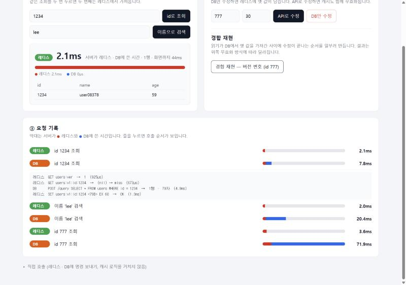

# 미니 레디스 개발 — 직접 만든 DB 앞에 직접 만든 레디스를 붙여 보기

> 미니 레디스 + 미니 DBMS + 웹 서버 + 화면(미니 리액트)을 하나로 묶어, 캐시가 실제로 얼마나 빨라지는지 비교

**결론: 차이를 만든 건 레디스의 속도가 아니라, DB가 해야 하는 일의 양**
- 이름 검색 (DB가 오래 일함) → **약 3배 빨라짐**
- id 조회 (DB가 이미 빠름) → 차이 없음
- 수정 1% 섞임 → 오히려 느려짐


## 목차
1. [왜 만들었나](#1-왜-만들었나)
2. [각각 어떻게 만들었나](#2-각각-어떻게-만들었나)
3. [합쳐서 테스트하기](#3-합쳐서-테스트하기)
4. [결과와 판단](#4-결과와-판단)
5. [실제 서비스와 다른 점](#5-실제-서비스와-다른-점)
6. [실행 · 테스트](#6-실행--테스트)
7. [한계](#7-한계)

---

## 1. 왜 만들었나

- **기대:** 레디스는 메모리에서 키 하나만 찾는다 → SQL을 처리하는 DB보다 빠를 것
- **실제:** 요청 하나씩 비교하니 차이가 거의 없음

  | id 조회 1번 | DB | 레디스 |
  |---|---|---|
  | 걸린 시간 | 1.96ms | 0.81ms |

- **이유:** DB가 id를 **B+트리 인덱스**로 찾음 → DB 안에서 1.9µs, 이미 충분히 빠름
- **그래서:** 둘을 합쳐 **웹 서버를 거치는 실제 요청 경로**로 비교

## 2. 각각 어떻게 만들었나

### 미니 레디스 (Java 21, 외부 라이브러리 없음)

| 항목 | 구현 |
|---|---|
| 통신 규격 | 진짜 레디스와 동일(RESP) → `redis-cli` · Jedis 그대로 사용 |
| 명령어 | `GET` `SET` `DEL` `EXISTS` `EXPIRE` `TTL` `INCR` `DBSIZE` `PING` |
| 실행 방식 | **스레드 하나**가 하나씩 실행 → 락 불필요<br>전제: 명령이 짧을 것. 긴 일은 나눠서 처리 |
| 해시 테이블 | 4칸에서 시작 → 차면 **두 배로 확장**<br>요청마다 한 칸씩 옮김(서버가 멈추지 않게), 옮기는 중엔 옛·새 배열 둘 다 검색 |
| 만료 | 읽을 때 확인 + 0.1초마다 20개 샘플링해 삭제 |

### 미니 DBMS (C++17)

| | 처음 | 수정 기능 추가 후 |
|---|---|---|
| 명령 | INSERT · SELECT | + UPDATE · DELETE |
| 저장 | 파일 하나에 이어 쓰기 | 변경 사항도 전부 파일 끝에 이어 쓰기 |
| 추가한 이유 | — | "DB가 바뀌면 캐시도 맞춰지나" 시험하려고 |
| 단점 | — | 옛 행을 안 지움 → **계속 수정하면 파일이 커짐** |

## 3. 합쳐서 테스트하기

### 구조

```
화면 (미니 리액트)
   │
   ▼
웹 서버 (Java)
   ├─▶ 미니 레디스   먼저 확인 → 있으면 바로 응답
   └─▶ 미니 DBMS     없으면 DB 조회 → 레디스에 60초 저장
```

### 두 종류의 조회

| | DB가 하는 일 | 속도 |
|---|---|---|
| **id 조회** `WHERE id = 777` | 인덱스로 1개 찾기 | 빠름 |
| **이름 검색** `WHERE name = 'lee'` | 인덱스 없음 → 10만 행 전부 확인 | 느림 |

### 화면 읽는 법

- **배지:** 어디서 끝났나 (레디스 / DB)
- **큰 숫자:** 서버가 레디스 + DB에 쓴 시간
- **막대:** 🟥 레디스 / 🟦 DB
- **요청 기록:** 같은 조회 두 번 → 위아래로 비교. 줄 클릭 → 호출 순서

### 이름 검색: 20.0ms → 2.7ms

| 처음 — DB까지 (20.0ms) | 다시 — 레디스에서 (2.7ms) |
|---|---|
|  |  |

- 두 번째엔 파란 막대(DB)가 사라짐

### 호출 순서: id 1234, 7.8ms → 2.1ms

- 처음: 레디스 확인 → 없음 → DB 조회 → 레디스 저장 (4번)
- 두 번째: 레디스 2번으로 끝
- 맨 아래 id 777(71.9ms)은 서버를 켠 직후 첫 요청이라 느림



### 요청 하나씩 보냈을 때

| | DB | 레디스 | 줄어든 시간 |
|---|---|---|---|
| id 조회 | 1.96ms | 0.81ms | 1.2ms |
| **이름 검색** | **6.1ms** | **1.0ms** | **5.1ms** |

## 4. 결과와 판단

**조건:** 10만 행 · 가상 사용자 8명 · 30초(k6) · 읽기 = id 80% + 이름 20% · 3회 중앙값

<!-- bench:start -->
| 수정 비율 | 캐시 | id 조회 | 이름 검색 | 레디스 적중률 |
|---|---|---|---|---|
| 0% | 켬 | 7.4ms | **10.7ms** | 60% |
| 0% | 끔 | 7.5ms | **28.8ms** | - |
| 1% | 켬 | 8.0ms | 26.0ms | 19% |
| 1% | 끔 | 6.7ms | 27.3ms | - |

원자료(수정 10% 포함): [bench/results/summary.md](bench/results/summary.md)
<!-- bench:end -->

| | 결과 | 의미 있나 |
|---|---|---|
| **이름 검색** | 28.8 → 10.7ms, **약 3배** | ✅ 있음 — 3회 모두 같은 방향 |
| id 조회 | 7.5 → 7.4ms | ❌ 없음 — DB가 이미 빠름 |
| 수정 1% | 캐시 켠 쪽이 더 느림 | ⚠️ 손해 — 수정마다 캐시 전체를 버림 → 적중률 60% → 19% |

- **핵심:** 캐시 효과 = DB가 하는 일의 양에 비례
- **효과 있는 조건:** 조회가 오래 걸림 + 데이터가 잘 안 바뀜
- **측정 주의:** 노트북 CPU 2개 → 처리량이 회차마다 최대 2.5배 흔들림. 3회 같은 방향만 결론으로, 측정마다 데이터 초기화

## 5. 실제 서비스와 다른 점

**구조는 같음, 조건은 DB에 유리 → 실제 서비스는 캐시 효과가 보통 더 큼**

| | 우리 | 실제 서비스 |
|---|---|---|
| 데이터 | 10만 행, 전부 메모리 | 메모리보다 큼 → 디스크 읽기 |
| 쿼리 | 테이블 1개, 조건 1개 | JOIN · 정렬 · 집계 |
| 동시 요청 | 8명 | 수천 명, DB 연결 수 한정 |
| 수정할 때 | 캐시 전체를 버림 | 바뀐 키만 삭제 |
| DB만 직접 수정 | 레디스는 모름 (60초간 옛 값) | DB 변경 기록(binlog)을 읽어 캐시 삭제(CDC) |

- **같은 점:** 기본 키 한 행 조회는 실제 DB도 빠름
- → 실제 서비스에서 캐시의 주 목적은 **DB로 가는 요청 수 줄이기**

## 6. 실행 · 테스트

```bash
docker compose up -d --build
```

| | |
|---|---|
| 화면 | http://127.0.0.1:8088 (첫 실행 때 10만 행 입력, 약 3초) |
| 초기화 | `bash scripts/reset.sh` |
| 측정 | `bash bench/run.sh` |
| 단위 테스트 | 웹 서버 23개 |
| 실제 스택 테스트 | 77개 `bash demo/test/e2e.sh` — 레디스 · DB 중단·복구, 경합 재현, 이상한 입력 |
| 원본 테스트 | 레디스 51 · DBMS 9 · 미니 리액트 198 |

- 원본 3개는 각자 저장소에서 개발 → 커밋 SHA 고정해 `vendor/`에 복사 (`VENDOR.md`)

## 7. 한계

- DB 파일이 수정할수록 커짐 — 옛 행 정리 기능 없음
- DB만 직접 수정하면 60초 만료까지 옛 값
- 레디스 데이터 파일 보존 없음 — DB 복사본이라 다시 채우면 됨
- 캐시가 버려진 직후 같은 키 요청이 DB로 몰리는 문제 — 관찰만 함
- SQL을 문자열로 조립 — 입력 검사 · 따옴표 처리로 방어
