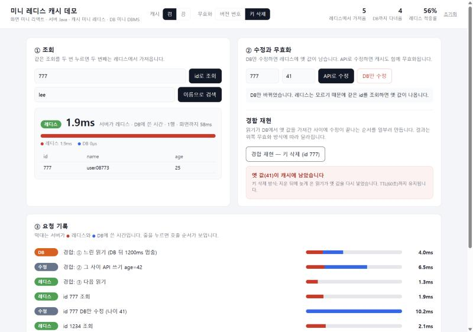
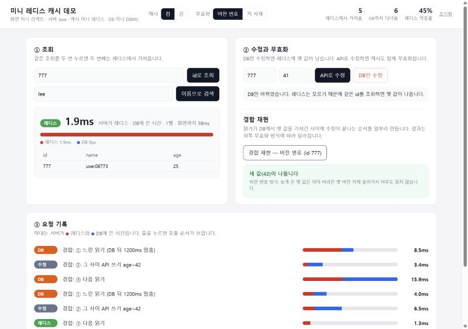
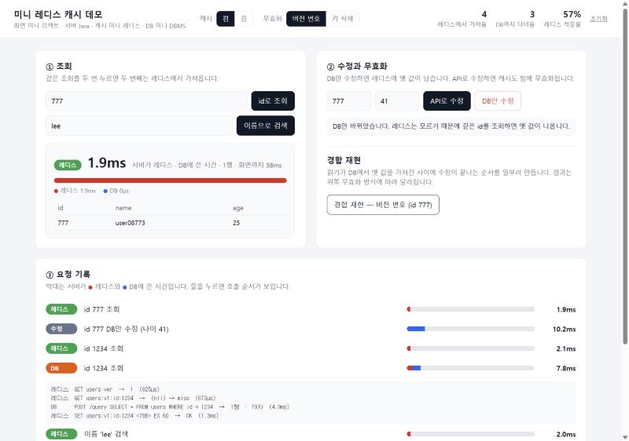

# 미니 레디스 개발 — 직접 만든 DB 앞에 직접 만든 레디스를 붙여 보기

직접 만든 미니 레디스를 미니 DBMS 앞에 캐시로 붙이고, 웹 서버와 화면(미니 리액트)까지 연결해서 실제로 얼마나 빨라지는지 비교했습니다.

**결론:** 캐시는 조회가 오래 걸리고 데이터가 잘 바뀌지 않을 때만 효과가 있었습니다. 이미 빠른 조회는 차이가 없었고, 수정이 1%만 섞여도 오히려 느려졌습니다.


## 목차
1. [구조](#1-구조)
2. [화면](#2-화면)
3. [만든 것](#3-만든-것)
4. [레디스와 DB 동기화](#4-레디스와-db-동기화)
5. [측정 결과](#5-측정-결과)
6. [실행 · 테스트](#6-실행--테스트)
7. [한계](#7-한계)

---

## 1. 구조

```
화면 (미니 리액트)
   │
   ▼
웹 서버 (Java)
   ├─▶ 미니 레디스   먼저 확인. 있으면 바로 응답
   └─▶ 미니 DBMS     없으면 DB에서 가져와 레디스에 60초 저장
```

세 부품(화면 엔진 · 레디스 · DBMS)은 모두 직접 만들었습니다. 원본은 각자 저장소에 있고, 이 저장소는 커밋 SHA를 고정해 `vendor/`에 복사해 씁니다(`VENDOR.md`).

## 2. 화면

요청 하나가 **레디스에서 끝났는지, DB까지 다녀왔는지, 각각 얼마나 걸렸는지**를 보여 줍니다.

- **상단:** 캐시 켬/끔, 무효화 방식(버전 번호 / 키 삭제), 레디스 적중 횟수 · DB 횟수 · 적중률
- **① 조회:** id 조회 또는 이름 검색. 배지 = 어디서 끝났는지, 큰 숫자 = 서버가 레디스와 DB에 쓴 시간, 막대 = 레디스(빨강) · DB(파랑) 비율
- **② 수정:** API로 수정(캐시 무효화함) / DB만 수정(무효화 안 함) / 경합 재현
- **③ 요청 기록:** 최근 8개. 줄을 누르면 서버가 레디스와 DB를 부른 순서가 펼쳐집니다

| 처음 검색 — DB까지 다녀옴 (20.0ms) | 같은 검색 다시 — 레디스 (2.7ms) |
|---|---|
|  |  |

## 3. 만든 것

**미니 DBMS에 수정 기능 추가.** 처음 DBMS는 넣기 · 조회만 돼서 "DB가 바뀌면 캐시도 맞춰지는가"를 시험할 수 없었습니다. 데이터가 깨지지 않게 파일은 뒤에 이어서만 쓰는 구조라, 그 원칙을 지키면서 넣었습니다.
- 수정: 바뀐 행 전체를 파일 끝에 새로 씀. 같은 id는 마지막 것이 최신
- 삭제: "지워짐" 기록(8바이트)을 파일 끝에 씀
- 대가: 수정할수록 파일이 커지고 전체 조회가 느려짐

**미니 레디스** (Java 21, 외부 라이브러리 없음)
- 진짜 레디스와 같은 통신 규칙(RESP) → `redis-cli` · Jedis를 그대로 붙여 씀
- 명령: `PING` `SET`(NX · XX · EX · PX) `GET` `DEL` `EXISTS` `EXPIRE` `TTL` `INCR` `DBSIZE`
- 스레드 하나가 명령을 하나씩 실행 → 락 없음. 대신 오래 걸리는 일은 나눠서 함
- 해시 테이블이 차면 두 배로 늘리되, 요청마다 한 칸씩 나눠 옮김(서버가 멈추지 않게)
- 만료: 읽을 때 확인 + 0.1초마다 20개씩 뽑아 지움

**단순 비교에서 차이가 거의 없었던 이유.** id 조회는 DB가 인덱스(B+트리)로 찾아 이미 빨랐습니다. DB 호출 1.96ms, 레디스 호출 0.81ms로 차이가 1ms 남짓입니다. 그래서 웹 서버와 화면을 붙여 실제 요청 경로 전체로 비교했습니다.

## 4. 레디스와 DB 동기화

### 기본 원칙: 수정할 때 레디스에 새 값을 넣지 않는다

DB를 수정해도 레디스에 새 값을 **밀어 넣지 않습니다.** 대신 레디스에 있는 옛 값을 **못 쓰게 만들고**, 다음 조회가 DB에서 새 값을 가져와 레디스를 다시 채웁니다. 진짜 데이터는 항상 DB에 있고, 레디스는 언제 지워져도 되는 복사본입니다.

### 버전 번호로 한 번에 못 쓰게 만들기

레디스에 버전 숫자 `users:ver` 하나를 두고, 모든 캐시 키 이름에 넣습니다.

```
users:ver = 8
캐시 키:  users:v8:id:777       (id 777 조회 결과)
          users:v8:name:lee     (이름 lee 검색 결과)
```

API로 수정하면 **DB 수정이 성공한 직후** 버전을 하나 올립니다(`INCR users:ver` → 9). 그러면 그다음 조회는 `users:v9:...`를 찾고, 없으니 DB에서 새 값을 가져옵니다. v8 키들은 아무도 읽지 않다가 60초 뒤 만료로 사라집니다.

### 언제 맞춰지나: 수정 한 번의 흐름

id 777의 나이를 25 → 41로 API로 수정할 때:

| 순간 | DB | 레디스 | 이때 조회하면 |
|---|---|---|---|
| 수정 전 | 25 | `v8:id:777` = 25 | 25 (레디스) |
| ① DB UPDATE 성공 | **41** | `v8:id:777` = 25 | 25 (레디스) ← 1ms 안팎의 틈 |
| ② `INCR users:ver` → 9 | 41 | v8 키는 남아 있지만 아무도 안 읽음 | — |
| ③ 다음 조회 | 41 | `v9:id:777` 없음 → DB에서 41을 가져와 저장 | **41 (DB)** |
| ④ 그다음 조회 | 41 | `v9:id:777` = 41 | 41 (레디스) |

**정리:** API로 수정하면 ②가 끝나는 순간부터 모든 조회가 새 값을 봅니다. 옛 값이 보일 수 있는 건 ①과 ② 사이, 같은 요청 안에서 1ms 안팎입니다.


### 순서가 DB 먼저, 버전 나중인 이유

반대로 하면 깨집니다. 버전을 먼저 9로 올리고 DB 수정 전에 누가 조회하면, 그 요청은 DB에서 **옛 값 25를 읽어 새 이름 `v9:id:777`에 넣습니다.** 그러면 DB 수정이 끝나도 60초 동안 25가 나옵니다.

### 키를 지우는 방식으로는 부족한 이유

버전 대신 수정한 키를 지우는(`DEL users:id:777`) 방식도 만들어 비교했습니다. 두 가지 문제가 있었습니다.

1. **검색 결과는 못 지웁니다.** id 777이 바뀌면 그 행이 들어 있는 검색 결과(`name:lee` 등)도 옛 값인데, 어떤 검색 키에 들어 있는지 알 수 없습니다.
2. **순서가 꼬이면 옛 값이 다시 들어갑니다.**
   - 요청 A가 DB에서 옛 값 25를 읽음 (아직 레디스에 넣기 전)
   - 요청 B가 DB를 41로 수정하고 키를 지움
   - 요청 A가 25를 레디스에 넣음 → 60초 동안 25

버전 방식에서는 A가 넣는 곳이 이미 버려진 v8 이름이라 아무도 읽지 않습니다. 화면의 "경합 재현" 버튼이 이 순서를 일부러 만듭니다.

| 키 삭제 → 옛 값 남음 | 버전 번호 → 새 값 |
|---|---|
|  |  |

### 동기화가 안 되는 경우: 마지막 안전망은 60초

| 상황 | 결과 | 얼마나 |
|---|---|---|
| API로 수정 | 바로 맞춰짐 | ~1ms |
| DB만 직접 수정 (웹 서버를 안 거침) | 레디스는 모름 → 옛 값 | 최대 60초 (빈 결과는 5초) |
| DB 수정 후 `INCR` 실패 (레디스 장애) | 버전이 안 올라감 → 옛 값 | 최대 60초 |
| DB 수정 실패 | 버전 안 올림 (바뀐 게 없으니) | — |
| 웹 서버 재시작 | 시작할 때 버전을 한 번 올림 → 이전 캐시 전부 무시 | — |

DB만 수정하면 옛 값이 그대로 나옵니다.



### 대가

행 하나만 바뀌어도 버전이 올라 **테이블 캐시 전체**가 버려집니다. 그래서 수정이 잦으면 캐시가 거의 적중하지 않습니다(5절 결과 3).

## 5. 측정 결과

<!-- bench:start -->
조건: 10만 행, 가상 사용자 8명이 30초 동안 계속 요청(k6). 읽기의 80%는 id 조회, 20%는 이름 검색. 3번씩 재서 중앙값(p50).

| 수정 비율 | 캐시 | id 조회 | 이름 검색 | 레디스 적중률 |
|---|---|---|---|---|
| 0% | 켬 | 7.4ms | **10.7ms** | 60% |
| 0% | 끔 | 7.5ms | **28.8ms** | - |
| 1% | 켬 | 8.0ms | 26.0ms | **19%** |
| 1% | 끔 | 6.7ms | 27.3ms | - |

1. **이름 검색은 약 3배 빨라졌습니다** (28.8 → 10.7ms). DB가 10만 행을 전부 확인하는 조회라 캐시 효과가 분명했습니다.
2. **id 조회는 차이가 없었습니다** (7.5 → 7.4ms). 이미 빠른 조회는 줄일 시간이 없었습니다.
3. **수정이 1%만 섞여도 캐시를 켠 쪽이 느렸습니다.** 수정마다 버전이 올라 적중률이 60% → 19%로 떨어졌고, 레디스를 거치는 시간만 더해졌습니다.

측정마다 데이터를 처음 상태로 되돌렸습니다(수정할수록 DB 파일이 커져서). 노트북 CPU 2개라 처리량은 회차마다 최대 2.5배 흔들려, 3번 모두 같은 방향인 것만 결론으로 썼습니다. 수정 10% 포함 전체 원자료: [bench/results/summary.md](bench/results/summary.md)
<!-- bench:end -->

## 6. 실행 · 테스트

Docker만 있으면 됩니다.

```bash
docker compose up -d --build
```

- 화면: http://127.0.0.1:8088 (처음 실행 때 10만 행을 넣음, 약 3초)
- 처음 상태로: `bash scripts/reset.sh` · 측정: `bash bench/run.sh`
- 테스트: 웹 서버 단위 23개, 실제 스택 77개(`bash demo/test/e2e.sh` — 레디스 · DB를 멈췄다 살리기, 경합 재현, 이상한 입력), 원본은 레디스 51 · DBMS 9 · 미니 리액트 198

## 7. 한계

- 레디스 데이터를 파일에 보존하지 않습니다. DB의 복사본이라 잃어도 다시 채워집니다.
- 노트북 한 대, CPU 2개에서 전부 돌아 측정값이 흔들립니다. 절대값보다 조건끼리 비교로 읽어 주세요.
- 캐시가 버려진 직후 같은 키 요청이 한꺼번에 DB로 몰리는 문제는 관찰만 했습니다.
- SQL을 문자열로 만듭니다. 입력 검사와 따옴표 처리로 막았지만, 근본 해결은 DBMS 쪽 작업입니다.
