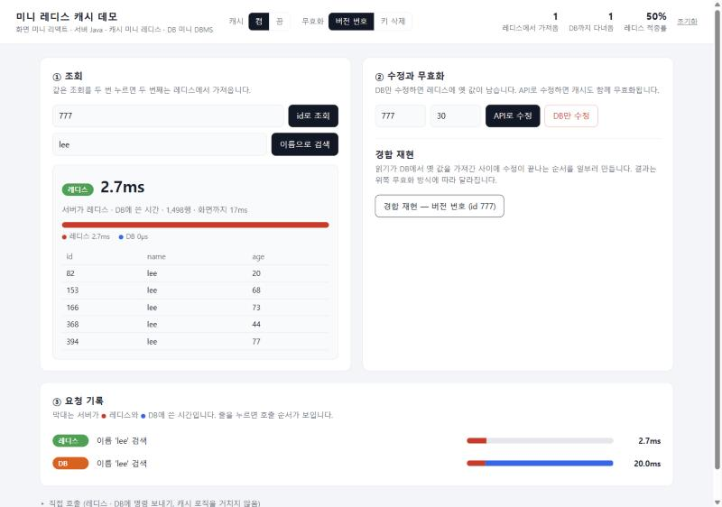

# 미니 레디스 개발 — 직접 만든 DB 앞에 직접 만든 레디스를 붙여 보기

직접 만든 미니 레디스를 직접 만든 미니 DBMS 앞에 붙여서, 레디스가 정말 DB보다 빠른지 실제 요청으로 확인해 봤습니다.

**결론:** 이름 검색처럼 DB가 오래 일해야 하는 조회는 약 3배 빨라졌습니다. 반대로 id 조회처럼 DB가 이미 빠른 조회는 차이가 없었고, 수정이 조금만 섞여도 오히려 느려졌습니다.



## 목차
1. [왜 만들었나](#1-왜-만들었나)
2. [합치기 전에: 각각 어떻게 만들었나](#2-합치기-전에-각각-어떻게-만들었나)
3. [합쳐서 테스트하기](#3-합쳐서-테스트하기)
4. [DB를 수정하면 레디스는 언제 맞춰지나](#4-db를-수정하면-레디스는-언제-맞춰지나)
5. [결과](#5-결과)
6. [유의미한 결과였나](#6-유의미한-결과였나)
7. [실행 · 테스트](#7-실행--테스트)
8. [한계](#8-한계)

---

## 1. 왜 만들었나

**레디스를 DB 앞에 붙여서 직접 테스트해 보고 싶었습니다.**

레디스는 키와 값을 메모리에 두는 저장소입니다. 보통 DB 앞에 캐시로 둡니다. 자주 읽는 값을 레디스에 넣어 두고, DB 대신 레디스에서 돌려줍니다.

레디스가 DB보다 빠르다고 하는 이유는 하는 일의 양이 다르기 때문입니다.

| | DB | 레디스 |
|---|---|---|
| 요청 | `SELECT * FROM users WHERE id = 777` | `GET users:id:777` |
| 하는 일 | SQL 문장 해석 → 인덱스 검색 → 파일에서 행 읽기 → 결과 변환 | 메모리 해시 테이블에서 키 하나 찾기 |

**그런데 두 개를 단순 요청으로 비교했더니 차이가 거의 없었습니다.**

| | DB | 레디스 |
|---|---|---|
| id 조회 1번 | 1.96ms | 0.81ms |

DB가 id를 B+트리 인덱스로 찾기 때문입니다. DB 안에서 id 하나를 찾는 시간은 1.9µs(100만 행 기준)로, 이미 충분히 빨랐습니다. 1ms 차이는 사람이 느낄 수 없습니다.

그래서 **둘을 합쳐서, 실제 서비스처럼 요청이 웹 서버를 거쳐 레디스와 DB로 가는 경로 전체에서 비교해 보기로 했습니다.**

## 2. 합치기 전에: 각각 어떻게 만들었나

### 미니 레디스

Java 21로, 외부 라이브러리 없이 만들었습니다.

**통신 규격을 진짜 레디스와 같게 만들었습니다(RESP).** 그래서 `redis-cli`나 Java 레디스 라이브러리(Jedis)를 고치지 않고 그대로 붙여 쓸 수 있습니다.

**기초 명령어를 구현했습니다.** `PING` `SET`(NX · XX · EX · PX 옵션) `GET` `DEL` `EXISTS` `EXPIRE` `TTL` `INCR` `DBSIZE`

**명령은 스레드 하나가 하나씩 실행합니다.** 여러 클라이언트가 동시에 접속해도 명령은 줄 서서 하나씩 처리됩니다. 그래서 락이 필요 없고, 명령 하나가 중간에 끊기지 않습니다.

단, 이건 **명령 하나가 아주 짧다는 전제**에서만 성립합니다. 명령 하나가 오래 걸리면 그동안 다른 모든 요청이 기다립니다. 그래서 오래 걸리는 일은 한 번에 하지 않고 나눠서 합니다. 아래 테이블 옮기기와 만료 정리가 그 예입니다.

**해시 테이블은 작게 시작해서 키가 늘면 커집니다.**
- 처음에는 칸 4개로 시작합니다.
- 키 수가 칸 수만큼 차면, 두 배 크기의 새 배열을 만듭니다.
- 키를 한 번에 다 옮기면 그동안 서버가 멈추므로, 요청이 올 때마다 한 칸씩 옮깁니다. 요청이 없을 때는 0.1초마다 조금씩 옮깁니다.
- 옮기는 동안에는 옛 배열과 새 배열을 둘 다 찾습니다. 새 키는 새 배열에만 넣습니다.
- 다 옮기면 옛 배열을 버립니다. 키가 많이 줄면 같은 방식으로 작게 줄입니다.

**만료:** 키를 읽을 때 기간이 지났으면 지웁니다. 아무도 안 읽는 키는 0.1초마다 20개씩 뽑아서 지웁니다.

### 미니 DBMS

C++로 만들었습니다.

**처음에는 삽입과 조회만 됐습니다.** 테이블마다 파일 하나에 행을 뒤에 이어서 쓰고, "id → 파일 위치"를 B+트리 인덱스에 둡니다. 데이터가 깨지지 않게 하려고, 이미 쓴 내용은 고치지 않는 구조였습니다.

**레디스와 합쳐서 테스트하려면 수정 기능이 필요했습니다.** 캐시를 붙이면 "DB 값이 바뀌었을 때 레디스도 맞춰지는가"를 확인해야 하는데, 값을 바꿀 방법이 없었기 때문입니다.

**그래서 변경 사항을 전부 파일 끝에 이어서 쓰도록 했습니다.**

| | 처음 | 수정 기능 추가 후 |
|---|---|---|
| 명령 | INSERT · SELECT | + UPDATE · DELETE |
| 수정 | 없음 | 바뀐 행 전체를 파일 끝에 새로 쓰고, 인덱스가 새 위치를 가리킴 |
| 삭제 | 없음 | "이 id는 지워짐" 기록을 파일 끝에 씀 |

기능은 잘 돌아갑니다. 하지만 **옛 행을 지우지 않고 계속 쌓기 때문에, 수정할수록 파일이 커집니다.** 파일이 커지면 전체를 확인하는 조회도 느려집니다. 그래서 측정할 때마다 데이터를 처음 상태로 되돌려야 했습니다. 쌓인 옛 행을 정리하는 기능은 만들지 않았습니다.

## 3. 합쳐서 테스트하기

앞에서 본 것처럼 단순 요청으로는 차이가 나지 않았습니다. 그래서 웹 서버를 만들어, 실제 요청을 웹 서버가 받아서 레디스와 DB에 나눠 보내도록 했습니다.

```
화면 (미니 리액트)
   │
   ▼
웹 서버 (Java)
   ├─▶ 미니 레디스   먼저 확인. 있으면 바로 응답
   └─▶ 미니 DBMS     없으면 DB에서 가져와 레디스에 60초 저장
```

화면은 예전에 만든 미니 리액트의 엔진을 가져와 새로 만들었습니다. 요청 하나가 **레디스에서 끝났는지, DB까지 다녀왔는지, 각각 얼마나 걸렸는지**를 보여 줍니다. 막대의 빨강은 레디스, 파랑은 DB 시간입니다.

**조회는 두 종류로 나눠서 비교했습니다.**
- **id 조회:** DB가 인덱스로 바로 찾습니다. 빠릅니다.
- **이름 검색:** 이름에는 인덱스가 없어서, DB가 10만 행을 전부 확인합니다. 느립니다.

| 이름 검색 처음 — DB까지 다녀옴 (20.0ms) | 같은 검색 다시 — 레디스에서 가져옴 (2.7ms) |
|---|---|
|  |  |

두 번째 검색에서는 파란 DB 시간이 사라졌습니다.

## 4. DB를 수정하면 레디스는 언제 맞춰지나

캐시를 붙이면 DB와 레디스에 같은 값이 두 군데 있게 됩니다. DB만 바꾸면 레디스는 그 사실을 모르기 때문에 옛 값을 계속 돌려줍니다.


**그래서 수정할 때 레디스의 옛 값을 못 쓰게 만듭니다.** 새 값을 레디스에 직접 넣지는 않습니다. 다음 조회가 DB에서 새 값을 가져와 레디스를 다시 채웁니다.

**방법: 캐시 키에 버전 번호를 넣었습니다.** 레디스에 버전 숫자 `users:ver`를 하나 두고, 모든 캐시 키 이름에 넣습니다(`users:v8:id:777`). 웹 서버로 수정하면 DB 수정이 성공한 직후 버전을 올립니다(`INCR users:ver` → 9). 그러면 이후 조회는 `users:v9:...`를 찾고, 없으니 DB에서 새 값을 가져옵니다.

id 777의 나이를 25 → 41로 수정할 때:

| 순간 | DB | 레디스 | 이때 조회하면 |
|---|---|---|---|
| 수정 전 | 25 | `v8:id:777` = 25 | 25 (레디스) |
| ① DB 수정 성공 | **41** | `v8:id:777` = 25 | 25 ← 1ms 안팎의 틈 |
| ② 버전 올림 → 9 | 41 | v8 키는 아무도 안 읽음 (60초 뒤 만료) | — |
| ③ 다음 조회 | 41 | `v9:id:777` 없음 → DB에서 41을 가져와 저장 | **41 (DB)** |
| ④ 그다음 조회 | 41 | `v9:id:777` = 41 | 41 (레디스) |

**DB를 먼저 바꾸고 버전을 나중에 올리는 이유:** 반대로 하면, 버전을 올린 직후 들어온 조회가 아직 안 바뀐 DB에서 옛 값을 읽어 새 버전 키에 넣어 버립니다.

**키를 지우는 방식과 비교했습니다.** 수정한 키만 지우는 방식(`DEL users:id:777`)도 만들어 봤는데, 두 가지가 안 됐습니다.
1. 그 행이 들어 있는 검색 결과(`name:lee` 등)는 어떤 키인지 몰라서 못 지웁니다.
2. 순서가 꼬이면 옛 값이 다시 들어갑니다. 조회 A가 DB에서 옛 값을 읽은 뒤, 수정 B가 키를 지우고, 그다음 A가 옛 값을 레디스에 넣는 경우입니다.

버전 방식에서는 A가 넣는 곳이 이미 버려진 옛 버전 키라서 아무도 읽지 않습니다. 화면의 "경합 재현" 버튼이 이 순서를 일부러 만듭니다.

| 키 삭제 → 옛 값이 남음 | 버전 번호 → 새 값 |
|---|---|
|  |  |

**맞춰지지 않는 경우에는 60초 만료가 마지막 안전망입니다.**

| 상황 | 옛 값이 남는 시간 |
|---|---|
| 웹 서버로 수정 | 1ms 안팎 |
| DB만 직접 수정 (웹 서버를 안 거침) | 최대 60초 |
| DB 수정 뒤 버전 올리기 실패 (레디스 장애) | 최대 60초 |

**대가:** 행 하나만 바뀌어도 버전이 올라서, 레디스에 있던 users 캐시가 전부 버려집니다.

## 5. 결과

### 요청 하나씩 보냈을 때

웹 서버가 레디스나 DB를 부르는 데 걸린 시간입니다(중앙값).

| | DB까지 다녀옴 | 레디스에서 가져옴 | 차이 |
|---|---|---|---|
| id 조회 | 1.96ms | 0.81ms | 1.2ms |
| **이름 검색** | **6.1ms** | **1.0ms** | **5.1ms** |

### 여러 명이 동시에 요청했을 때

10만 행, 가상 사용자 8명이 30초 동안 계속 요청했습니다(k6). 읽기의 80%는 id 조회, 20%는 이름 검색입니다. 같은 조건을 3번씩 재서 중앙값을 적었습니다.

<!-- bench:start -->
| 수정 비율 | 캐시 | id 조회 | 이름 검색 | 레디스 적중률 |
|---|---|---|---|---|
| 0% | 켬 | 7.4ms | **10.7ms** | 60% |
| 0% | 끔 | 7.5ms | **28.8ms** | - |
| 1% | 켬 | 8.0ms | 26.0ms | 19% |
| 1% | 끔 | 6.7ms | 27.3ms | - |

원자료(수정 10% 포함): [bench/results/summary.md](bench/results/summary.md)
<!-- bench:end -->

**결과 요약**
1. **이름 검색은 28.8ms → 10.7ms로 약 3배 빨라졌습니다.**
2. **id 조회는 7.5ms → 7.4ms로 차이가 없었습니다.**
3. **수정이 100번에 1번만 섞여도, 캐시를 켠 쪽이 더 느렸습니다.** 수정할 때마다 버전이 올라 캐시가 전부 버려집니다. 그래서 레디스 적중률이 60%에서 19%로 떨어졌고, 레디스를 거치는 시간만 더해졌습니다.

## 6. 유의미한 결과였나

**이름 검색은 유의미했습니다.** 3번 모두 같은 방향으로 약 3배 빨라졌습니다. 요청 하나씩 보낸 측정에서도 DB 6.1ms가 레디스 1.0ms로 줄었습니다.

**id 조회는 의미 있는 차이가 없었습니다.** DB가 B+트리로 이미 빠르게 찾기 때문에, 레디스가 줄일 시간이 거의 없었습니다. 처음 단순 비교에서 차이가 안 났던 것과 같은 이유입니다.

**결국 차이를 만든 건 레디스의 속도가 아니라, DB가 해야 하는 일의 양이었습니다.**

| | DB가 하는 일 | 캐시 효과 |
|---|---|---|
| id 조회 | 인덱스로 1개 찾기 | 없음 |
| 이름 검색 | 10만 행 전부 확인 | 약 3배 |
| 수정이 섞일 때 | — | 오히려 느려짐 |

캐시는 **조회가 오래 걸리고, 데이터가 잘 바뀌지 않을 때** 효과가 있었습니다.

**측정을 믿을 수 있는 정도:** 노트북 한 대, CPU 2개에서 모든 프로그램이 같이 돌아서 처리량이 회차마다 최대 2.5배 흔들렸습니다. 그래서 처리량 대신 조회 종류별 시간과 적중률로 판단했고, 3번 모두 같은 방향으로 나온 것만 결론으로 썼습니다. 절대값보다는 조건끼리의 비교로 읽어 주세요.

## 7. 실행 · 테스트

Docker만 있으면 됩니다.

```bash
docker compose up -d --build
```

- 화면: http://127.0.0.1:8088 (처음 실행 때 10만 행을 넣음, 약 3초)
- 처음 상태로 되돌리기: `bash scripts/reset.sh`
- 측정: `bash bench/run.sh`
- 테스트:
  - 웹 서버 단위 테스트 23개
  - 실제 스택 테스트 77개(`bash demo/test/e2e.sh`): 레디스 · DB를 멈췄다 살리기, 경합 재현, 이상한 입력
  - 원본 저장소 테스트: 레디스 51개 · DBMS 9개 · 미니 리액트 198개

원본 세 개는 각자 저장소에서 만들고, 이 저장소는 커밋 SHA를 고정해 `vendor/`에 복사해 씁니다(`VENDOR.md`).

## 8. 한계

- DB 파일이 수정할수록 커집니다. 쌓인 옛 행을 정리하는 기능은 없습니다.
- 레디스 데이터를 파일에 저장하지 않습니다. DB의 복사본이라, 잃어도 DB에서 다시 채울 수 있습니다.
- 캐시가 버려진 직후 같은 키 요청이 한꺼번에 DB로 몰리는 문제는 관찰만 하고 막지 않았습니다.
- SQL을 문자열로 만듭니다. 입력 검사와 따옴표 처리로 막았지만, 근본적인 해결은 DBMS 쪽 작업입니다.
